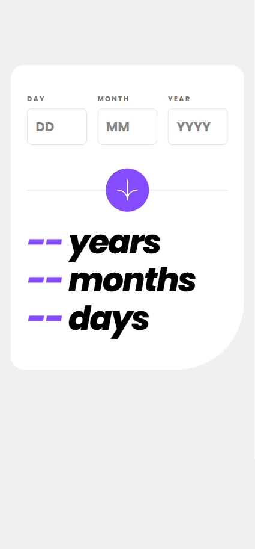
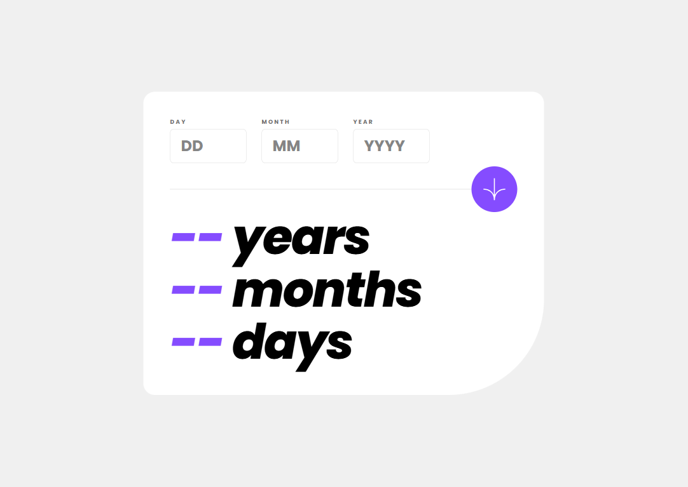
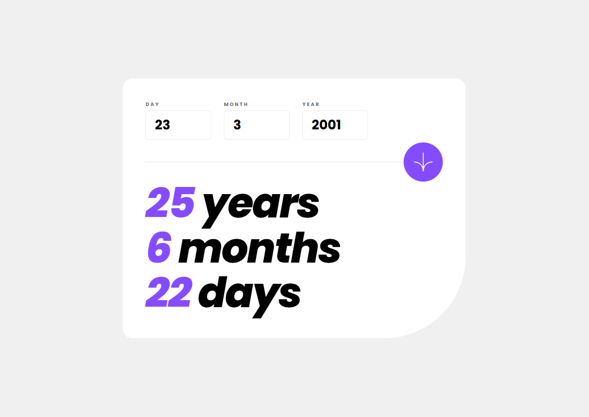

# Frontend Mentor - Age calculator app solution

This is my solution to the [Age calculator app challenge on Frontend Mentor](https://www.frontendmentor.io/challenges/age-calculator-app-dF9DFFpj-Q). Frontend Mentor challenges help improve coding skills by building realistic projects.

## Table of contents

- [Overview](#overview)
  - [The challenge](#the-challenge)
  - [Screenshot](#screenshot)
  - [Links](#links)
- [My process](#my-process)
  - [Built with](#built-with)
  - [What I learned](#what-i-learned)
  - [Continued development](#continued-development)
  - [Useful resources](#useful-resources)
  - [AI collaboration](#ai-collaboration)
- [Author](#author)
- [Acknowledgments](#acknowledgments)

## Overview

### The challenge

Users should be able to:

- View their age in years, months, and days after submitting a valid date through the form.
- Receive validation errors if:
  - Any field is empty when the form is submitted.
  - The day number is not between 1 and 31.
  - The month number is not between 1 and 12.
  - The year is in the future.
  - The date is invalid, such as 31/04/1991 (April has 30 days).
- View an optimal layout depending on their device's screen size.
- See hover and focus states for interactive elements.
- **Bonus:** See the age numbers animate to their final values when the form is submitted.

### Screenshot

Add a screenshot of your finished project to the project root and name it `screenshot.jpg`. If you use a different filename or location, update the image path below.





### Links

- Github Repo URL: [Github Repo URL](https://github.com/stephany247/age-calculator-app)
- Live Site URL: [Live site URL](https://stephany247.github.io/age-calculator-app/)


## My process

### Built with

- Semantic HTML5 markup
- CSS custom properties
- Flexbox and CSS Grid
- Responsive design
- Mobile-first workflow
- Vanilla JavaScript
- Form validation and date calculations
- `requestAnimationFrame` for animated results
- Accessibility features, including associated labels and live announcements

### What I learned

This project helped me practise validating user input and calculating an age accurately using JavaScript dates. I also worked on making custom validation messages clear and handling invalid calendar dates, such as 31 April.

One useful lesson was that JavaScript's `Date` object can automatically roll invalid dates into the following month. Comparing the constructed date with the submitted day, month, and year helps detect those invalid dates.

```js
const candidate = new Date(year, month - 1, day);

const isRealDate =
  candidate.getFullYear() === year &&
  candidate.getMonth() === month - 1 &&
  candidate.getDate() === day;
```

I also practised animating the result values and considering reduced-motion preferences so the interface can be more comfortable for users who prefer less animation.

### Continued development

In future projects, I want to keep improving my JavaScript date handling, form validation, accessibility, and responsive CSS. I also want to test interfaces more thoroughly across different screen sizes and with keyboard navigation and screen readers.

### Useful resources

- [Frontend Mentor](https://www.frontendmentor.io/) - The challenge provided the design and requirements for the project.
- [MDN: JavaScript Date](https://developer.mozilla.org/en-US/docs/Web/JavaScript/Reference/Global_Objects/Date) - Useful reference for working with dates and date components.
- [MDN: Constraint validation](https://developer.mozilla.org/en-US/docs/Web/HTML/Constraint_validation) - Explains browser form validation and custom validation approaches.
- [The Markdown Guide](https://www.markdownguide.org/) - Helpful reference for writing and formatting README files.

### AI collaboration

I used ChatGPT as a coding assistant during development to discuss debugging, validation behaviour, responsive styling, accessibility improvements, and documentation.

AI suggestions were reviewed and adapted to the project rather than treated as a substitute for testing. I checked the code and made decisions about which changes fit the app's requirements.

## Author

- Frontend Mentor: [Frontend Mentor username](https://www.frontendmentor.io/profile/stephany247)
- GitHub: [GitHub profile URL](https://github.com/stephany247)


## Acknowledgments

Thanks to Frontend Mentor for providing the challenge and design brief. The project was also an opportunity to practise frontend development, validation, responsive design, and accessibility.
